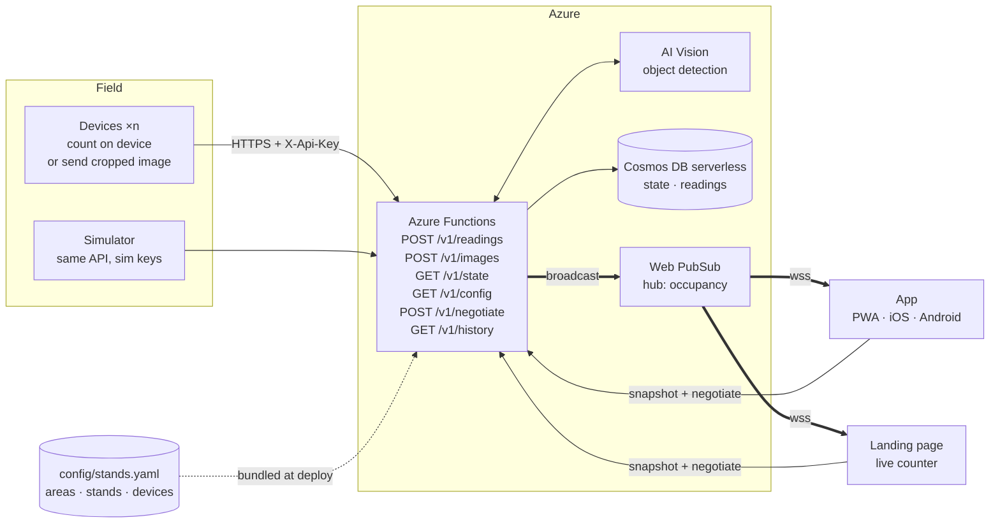
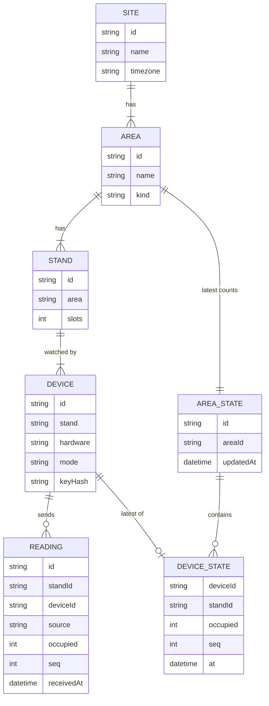

# Velo Stands architecture

BaselHack 2026 · Endress+Hauser "Find my Bike Slot"

> "Velo Stands" is a working name.

Devices at each bike stand report how many bikes they see over HTTPS. Each device counts on its own hardware or uploads an image that an Azure model counts. Azure Functions keep the latest state in Cosmos DB and push every change over Web PubSub to two front ends. The **app** is one build that runs as a PWA and, wrapped in Capacitor, on iOS and Android. The **landing page** promotes the project. Nobody logs in.

The first version only covers the API, the shared contracts, the tools and an unstyled PWA. See [build-v1.md](build-v1.md).

## Decisions

| Topic | Decision |
|---|---|
| Front ends | Two Next.js apps. The **app** is a PWA and, wrapped in Capacitor, the iOS and Android app. The **landing page** promotes the project and links to the app. |
| Push | Azure Web PubSub. Standard S1 for the demo, because the Free tier caps at 20 connections. |
| Database | Cosmos DB for NoSQL, serverless. |
| Device keys | One API key per device. Only SHA-256 hashes go in the public repo, and the keys themselves are flashed to the devices. |
| Config | YAML in the repo, validated with Zod in CI. |
| Stands | A stand has a number of slots and any number of devices. Each device sends the number of bikes it sees. Free slots = slots − the sum of all its devices' counts. |
| Devices | Devices on one stand never watch the same bikes. There are no slot ranges, no voting and no estimates for unwatched places. |
| Counting | Either on the device, or in the cloud from an uploaded image. A cloud device may also send its own count, which is stored for comparison only. |
| Recognizer | Azure AI Vision, Image Analysis object detection, counting the boxes labelled `bicycle`. |
| Images | Never stored. An image is held in memory for one recognition call and then dropped. Only the count is kept. |

## How the pieces connect



## Components

| Part | Tech | Job |
|---|---|---|
| Devices | ESP32 cameras, LiDAR, ToF, whatever we test | Every 60 s, or on change: send a count or an image. TLS uses the ESP certificate bundle, so Azure certificate rotations don't break the devices. |
| Config | `config/stands.yaml` | The single source of truth for areas, stands and devices. CI validates it. The build copies it into the Function App, and copies a public subset (without hashes) into the front ends. |
| API | Azure Functions, Node 22, TypeScript | Authenticates devices, counts uploaded images, stores readings, adds up stands and areas, broadcasts changes and serves the snapshot. |
| Recognition | Azure AI Vision, Image Analysis object detection | Counts the boxes labelled `bicycle` above a confidence threshold set in the config. |
| Database | Cosmos DB for NoSQL, serverless | Holds the latest state per area, plus raw readings with a TTL for history. |
| Push | Azure Web PubSub | Sends each area update to every connected client. |
| App | Next.js static export, Serwist, Capacitor | The product: where to park right now. One build runs as an installable PWA at `app.<domain>`, and Capacitor wraps the same build for iOS and Android. |
| Landing page | Next.js static export | Promotes the project: the problem, how it works, privacy by design and the team. It shows one live counter and links to the PWA and the store builds. It is served at the root domain and is the page behind the pitch QR code. |
| Shared UI | `packages/ui` | shadcn/ui components, the Tailwind theme and the brand tokens, used by both front ends. |
| Contracts | `packages/contracts` | TypeScript types, Zod schemas and `computeViews`, used by the API and both front ends. |

## What we use

### Apps and tooling

| Tool | What it does for us |
|---|---|
| [Next.js](https://nextjs.org) | React framework for the app and the landing page. Both are static exports, so they need no server, and Capacitor can wrap the app's output. |
| [Capacitor](https://capacitorjs.com) | Wraps the app's build in native Android and iOS shells. |
| [Serwist](https://serwist.pages.dev) | Service worker and offline caching for the PWA, with a Next.js plugin. |
| [Tailwind CSS](https://tailwindcss.com) | Utility-first CSS. |
| [shadcn/ui](https://ui.shadcn.com) | Copy-in React components built on Radix and Tailwind. |
| [Radix UI](https://www.radix-ui.com) | Unstyled, accessible primitives that shadcn/ui is built on. |
| [three.js](https://threejs.org) + [React Three Fiber](https://r3f.docs.pmnd.rs) | The 3D campus model. |
| [Zod](https://zod.dev) | Schemas for the config, readings and push messages. |
| [pnpm](https://pnpm.io) | Package manager and workspaces. |
| [Oxlint](https://oxc.rs/docs/guide/usage/linter) | A fast linter. |
| [Oxfmt](https://oxc.rs/docs/guide/usage/formatter) | A Prettier-compatible formatter. Prettier is the fallback if it breaks on something. |
| [Vitest](https://vitest.dev) | Test runner. |

### Azure

| Service | What it does for us |
|---|---|
| [Azure Functions](https://learn.microsoft.com/azure/azure-functions/) | Serverless API. |
| [Cosmos DB serverless](https://learn.microsoft.com/azure/cosmos-db/serverless) | Pay-per-request database. |
| [Web PubSub](https://learn.microsoft.com/azure/azure-web-pubsub/) | Managed WebSockets. |
| [AI Vision Image Analysis](https://learn.microsoft.com/azure/ai-services/computer-vision/overview-image-analysis) | Prebuilt object detection. |
| [Static Web Apps](https://learn.microsoft.com/azure/static-web-apps/) | Hosting for both front ends. |
| [Bicep](https://learn.microsoft.com/azure/azure-resource-manager/bicep/) | Infrastructure as code. |

## What happens when a bike is parked

1. Stand `fsw-1` at Flow South West has 20 slots and two devices. `cam-01` counts 9 bikes itself and sends `POST /v1/readings`. `cam-02` sends a cropped JPEG to `POST /v1/images`.
2. The Function hashes the API key and finds the device in the bundled config, which gives it the stand and the mode. The device never says who it is in the request body.
3. For an image, the Function calls the recognizer, counts the bicycles (say 8) and drops the image. From here on both paths are the same.
4. It appends the reading to `readings` with its source and stores the device's latest count in `state`. The stand then has 20 − (9 + 8) = 3 free slots. The area total is the sum of its stands.
5. If an area's free count or stale flag changed, it broadcasts one small JSON message through Web PubSub, and every open client updates within about a second.

A client that opens later first fetches `GET /v1/state`, then calls `/negotiate` and opens the WebSocket for changes. After a reconnect it fetches the snapshot again, so it never misses an update without noticing.

## Config file

Areas are the six real bike parking areas on the campus. A stand belongs to an area and has slots, and each device belongs to a stand. An area's free and total places are the sums over its stands.

```yaml
# config/stands.yaml
version: 1
site:
  id: reinach
  name: Endress+Hauser Reinach
  timezone: Europe/Zurich

areas:
  - id: flow-sw
    name: Flow South West
    kind: covered            # covered | inside | open
  # … flow-main, sternenhof, flow-garage-south, flow-se, flow-garage-north

stands:
  - id: fsw-1
    area: flow-sw
    slots: 20

devices:
  - id: cam-01
    stand: fsw-1
    hardware: esp32-cam
    mode: device             # device: sends a count · cloud: sends an image
    keyHash: "sha256:9f2c…e41a"
  - id: cam-02
    stand: fsw-1
    hardware: esp32-s3-cam
    mode: cloud
    keyHash: "sha256:51b0…07cd"

recognition:
  model: azure-ai-vision     # Image Analysis, object detection
  label: bicycle
  minConfidence: 0.5

settings:
  staleAfterSeconds: 300
  readingTtlDays: 30
```

To add a device, run `pnpm device:add cam-03 --stand fsw-1 --mode cloud` and open a pull request. The command prints the key once, for flashing, and writes only the hash into the file. Point the devices on one stand at different bikes; the backend just adds up their counts.

## Device API

There are two endpoints, and both use the same API key header. The key identifies the device, and everything else about the device comes from the config.

### Count from the device

```http
POST /api/v1/readings
X-Api-Key: vs_3q9Z…
Content-Type: application/json

{ "occupied": 9, "seq": 1842, "measuredAt": "2026-10-31T07:42:10Z", "fw": "0.3.1", "rssi": -61 }
```

```json
202 { "device": "cam-01", "nextInSeconds": 60 }
```

### Image for cloud counting

```http
POST /api/v1/images
X-Api-Key: vs_8kLm…
Content-Type: image/jpeg
X-Seq: 1843
X-Device-Count: 9

<JPEG cropped to the stand, ≤ 640 px long side, ≤ 1 MB>
```

`X-Device-Count` is optional and stored for comparison only.

```json
200 { "device": "cam-02", "occupied": 8, "source": "cloud", "nextInSeconds": 60 }
```

### Errors

| Status | When |
|---|---|
| 401 | The key is unknown or missing. |
| 409 | The endpoint doesn't match the device's mode: an image from a `device`-mode device, or a count from a `cloud`-mode one. |
| 413 / 415 | The image is too large, or isn't JPEG or PNG. |
| 422 | The JSON body is invalid: a negative count, a count above the stand's slots, or an unknown field. |
| 429 | One device sent more than one request in 5 s. |
| 502 | The recognizer failed. The device retries next cycle, and the stand keeps its last count until it goes stale. |

- The JSON schema has no field that could carry an image, and unknown fields are rejected. Images only go through `/images`, which never stores them.
- `seq` lets the server drop duplicates and out-of-order retries. Each device sends at least every 60 s, which also serves as its heartbeat.
- The server compares key hashes in constant time. Rotating a key means changing the config and reflashing one device.

## Client API and WebSocket push

The client endpoints need no authentication. They are all read-only and return counts only.

| Endpoint | Returns |
|---|---|
| `GET /api/v1/state` | `Snapshot` |
| `GET /api/v1/config` | The public config, without key hashes |
| `POST /api/v1/negotiate` | `{ url }`, a short-lived Web PubSub URL that can only receive |
| `GET /api/v1/history?stand=…&from=…&to=…` | The stand's readings, oldest first |

```json
GET /api/v1/state
{
  "at": "2026-10-31T07:42:11Z",
  "areas": [
    { "id": "flow-sw", "name": "Flow South West", "kind": "covered",
      "capacity": 20, "free": 3, "stale": false,
      "stands": [ { "id": "fsw-1", "slots": 20, "occupied": 17, "free": 3, "stale": false } ] }
  ]
}
```

```js
// browser and Capacitor app alike
const { url } = await (await fetch(`${API}/api/v1/negotiate`, { method: "POST" })).json();
const ws = new WebSocket(url);
ws.onmessage = (e) => apply(JSON.parse(e.data));

// each message
{ "type": "area", "id": "flow-sw", "capacity": 20, "free": 3, "stale": false, "at": "…" }
```

- The ingest Functions broadcast directly through Web PubSub.
- A timer Function runs every minute. It marks areas stale when their devices go quiet and broadcasts that change too.
- For a stand with a cloud device that also sends its own count, `/history` shows the device count and the cloud count side by side.

## Data model

The data model has three layers:
- **Config** describes what exists. It comes from `stands.yaml` and changes only by pull request.
- **Stored** is what the devices told us, kept in Cosmos DB.
- **Views** are computed from the two on every read and never stored, so no derived number can drift.



### Config (`packages/contracts`)

```ts
type AreaKind = "covered" | "inside" | "open";
type DeviceMode = "device" | "cloud"; // sends a count | sends an image

interface Site   { id: string; name: string; timezone: string }
interface Area   { id: string; name: string; kind: AreaKind }
interface Stand  { id: string; area: Area["id"]; name?: string; slots: number } // slots >= 1
interface Device {
  id: string;
  stand: Stand["id"];
  hardware: string;            // "esp32-cam", "rplidar-c1", … free text
  mode: DeviceMode;
  keyHash: `sha256:${string}`; // never shipped to the front ends
}
interface Recognition { model: "azure-ai-vision"; label: "bicycle"; minConfidence: number }
interface Settings    { staleAfterSeconds: number; readingTtlDays: number }

interface Config {
  version: 1; site: Site; areas: Area[]; stands: Stand[]; devices: Device[];
  recognition: Recognition; settings: Settings;
}
```

CI also checks what the types can't: ids are unique per kind, every `area` and `stand` reference resolves, every area has at least one stand, every stand has at least one device, and key hashes are unique.

### Stored (Cosmos DB)

```ts
// container "readings", partition key /standId, default TTL 30 days
interface Reading {
  id: string;              // uuid
  standId: string;
  areaId: string;          // denormalised for history by area
  deviceId: string;
  source: "device" | "cloud";
  occupied: number;        // bikes this device sees, 0 … stand.slots
  deviceCount?: number;    // cloud only: the device's own count, for comparison
  model?: string;          // cloud only
  meanConfidence?: number; // cloud only: of detections above the threshold
  seq: number;
  measuredAt?: string;     // ISO 8601, only if the device has NTP time
  receivedAt: string;
  fw?: string;
  rssi?: number;
}

// container "state", partition key /areaId, one document per area, no TTL
interface AreaState {
  id: string;              // = areaId
  areaId: string;
  devices: Record<string, DeviceState>; // keyed by deviceId
  updatedAt: string;
}
interface DeviceState {
  standId: string;
  occupied: number;
  source: "device" | "cloud";
  seq: number;
  at: string;              // receivedAt of the reading that set it
}
```

Ingest writes one device's entry with a Cosmos **patch** (`set /devices/cam-01`), guarded by `seq`. That way two devices in the same area never overwrite each other, and no read-modify-write is needed. Nothing else is stored: no images, no people and no identity for individual bikes.

### Views (computed on read)

```ts
interface StandView  { id: string; slots: number; occupied: number; free: number; stale: boolean }
interface AreaView   { id: string; name: string; kind: AreaKind;
                       capacity: number; free: number; stale: boolean; stands: StandView[] }
interface Snapshot   { at: string; areas: AreaView[] }                 // GET /v1/state
interface AreaUpdate { type: "area"; id: string; capacity: number;
                       free: number; stale: boolean; at: string }       // WebSocket message
```

| Value | Rule |
|---|---|
| `stand.occupied` | The sum of the latest `occupied` of every device on the stand. A device that never reported counts as 0. |
| `stand.free` | `max(0, slots − occupied)`. It is clamped because two cameras can both see a bike on their shared edge. |
| `stand.stale` | True if any of its devices has not reported within `staleAfterSeconds`, or has never reported. |
| `area.capacity` / `area.free` | The sum of its stands' `slots` / `free`. Places that no device watches don't appear. |
| `area.stale` | True if any of its stands is stale. |

These rules live in one pure function, `computeViews(config, states, now)`, in `packages/contracts`. It is tested with Vitest and used by both `/state` and the broadcast.

**Volume.** Ten devices reporting once a minute make about 14,000 readings a day, which costs a few cents in serverless request units. Image recognition is the larger cost, at roughly a franc per thousand images, so cloud-mode devices may want to report less often.

