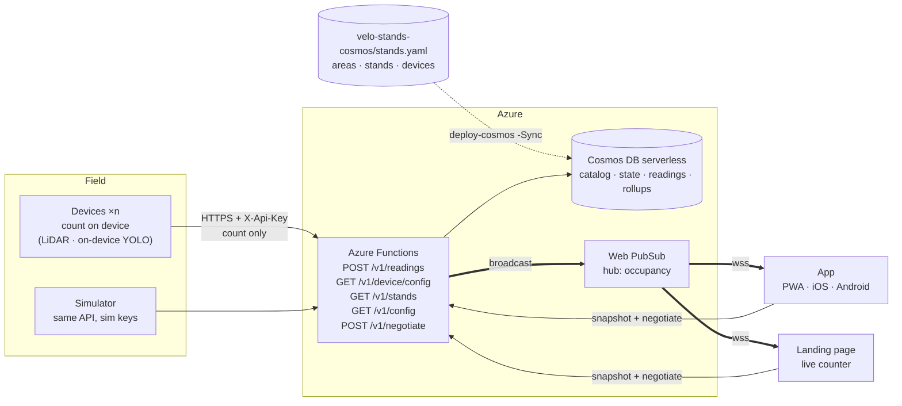
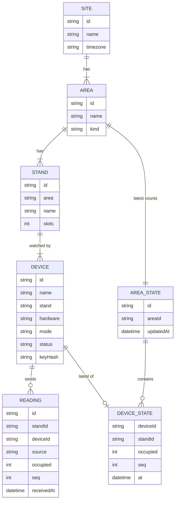

# Velo Stands architecture

BaselHack 2026 · Endress+Hauser "Find my Bike Slot"

> "Velo Stands" is a working name.

Devices at each bike stand count the bikes they see and report the number — never an image — over HTTPS. Azure Functions keep the latest state in Cosmos DB and push every change over Web PubSub to two front ends. The **app** is one build that runs as a PWA and, wrapped in Capacitor, on iOS and Android. The **landing page** promotes the project. Nobody logs in.

## Privacy stance: no images leave the stand

This is a privacy-by-design challenge. We count **without ever sending an image off the device**:

- Each device turns its raw signal (point cloud, on-device YOLO detections) into one integer: the number of bikes it currently sees.
- Only that integer, plus a few housekeeping fields, reaches the backend.
- There is no cloud image endpoint. The sensor and the firmware are the whole pipeline.

See [sensor-evaluation.md](sensor-evaluation.md) for the sensors we test and the numbers we measure.

## Counting: two solutions

A stand has slots, and one or more devices watch them. We offer two sensor types; the stand picks one based on size, sightline and where we can mount hardware.

**LiDAR — preferred.** A single 360° head on the ceiling scans the full arc, splits it into one angular bay per slot and thresholds the nearest return per bay. One device covers a whole stand, and because the signal is depth and not an image, it is unaffected by light, rain and snow — day, night, all weather. This is the first choice whenever a ceiling or beam mount is available. The firmware is in [`code/firmware/thor`](../code/firmware/thor).

**On-device YOLO on ESP32 — where LiDAR can't be mounted.** An AtomS3R-CAM runs the Espressif ESP-DL `coco_detect` YOLO11n model on every captured frame and POSTs the count of `bicycle` detections. The frame stays in RAM; only the integer leaves the device. Each stand needs **two cameras**, mounted **top-left** and **top-right** of the stand and angled **≈ 30°** downward into it, so the two viewpoints cross-check and together cover the full row. The backend sums the two counts like any other devices on a stand. The firmware is in [`code/firmware/mule`](../code/firmware/mule) and [`code/firmware/hydra`](../code/firmware/hydra); the debug app receives the last analysed frame as a side channel, held in memory only.

Both solutions use the same `POST /v1/readings` path and the same per-device API key.

**Uplink.** We tested the firmware over campus Wi-Fi + HTTPS (fast to iterate, no gateway required), but for production we recommend **LoRaWAN**: campus Wi-Fi doesn't reach every stand (open yards, basement garages, remote racks), and a LoRaWAN node can run on a battery charged by a small solar panel, with no mains cabling. The gateway relays uplinks over HTTPS to the Function App, so the backend contract is unchanged. See [sensor-evaluation.md](sensor-evaluation.md) for details.

### What is deployed

This is the catalog as it stands in Cosmos DB (loaded from `stands.yaml`):

| Area | Kind | Stand | Slots | Devices |
| ---- | ---- | ----- | ----: | ------- |
| Flow Main | covered | `flow-main-1` | 40 | `ghost` LiDAR · `raven` YOLO camera |
| Sternenhof | covered | `sternenhof-1` | 30 | `medic` LiDAR · `reaper` YOLO camera |
| Flow Garage South | inside | `flow-garage-south-1` | 30 | `roach` LiDAR · `probe` YOLO camera |
| Flow South West | covered | `flow-sw-1` | 20 | `mule` + `hydra`, two YOLO cameras |
| Flow South East | covered | `flow-se-1` | 10 | `thor` LiDAR |
| Flow Garage North | covered | `flow-garage-north-1` | 20 | `ling` LiDAR |
| **6 areas** | | **6 stands** | **150** | **10 devices: 5 LiDAR, 5 YOLO cameras** |

Three stands combine one LiDAR with one camera, and the backend adds up their counts. Flow South West uses the two-camera setup described above. Slot counts are placeholders until Endress+Hauser confirms the real capacities, and no stand has a GPS `location` yet. Every device is `mode: device` and `status: active`; the assignments come from `devices[].stand` and start on 2026-10-31. Only `thor` has a `config:` block so far.

The first version only covers the API, the shared contracts, the tools and an unstyled PWA. See [build-v1.md](build-v1.md).

## Decisions

| Topic | Decision |
|---|---|
| Front ends | Two Next.js apps. The **app** is a PWA and, wrapped in Capacitor, the iOS and Android app. The **landing page** promotes the project and links to the app. |
| Push | Azure Web PubSub. Standard S1 for the demo, because the Free tier caps at 20 connections. |
| Database | Cosmos DB for NoSQL, serverless. |
| Device keys | One API key per device. Only SHA-256 hashes go in the public repo, and the keys themselves are flashed to the devices. |
| Config | YAML in the repo, validated with Zod in CI. |
| Stands | A stand has a number of slots and any number of devices. Each device sends the number of bikes it sees. Free slots = slots − the sum of all its devices' counts. |
| Devices | Devices on one stand never watch the same bikes. There are no slot ranges, no voting and no estimates for unwatched places. |
| Counting | Two on-device solutions, both reporting only the integer: **LiDAR** (preferred, one head per stand, works day/night/rain/snow) and **on-device YOLO on ESP32** where LiDAR can't be mounted (two cameras per stand, top-left and top-right, 30° downward into the stand). |
| Sensor choice | Decided per stand. LiDAR by default; on-device YOLO when the stand has no mounting point a LiDAR can see from. See [sensor-evaluation.md](sensor-evaluation.md). |
| Images | The ingest path never sees one. The debug app exposes a side channel for cameras to upload the latest frame they analysed; those bytes are kept in memory only and never written to Cosmos. |

## How the pieces connect



## Components

| Part | Tech | Job |
|---|---|---|
| Devices | **LiDAR** (RPLidar C1 on an AtomS3) — one per stand, scans a 360° arc and classifies each slot by depth. **On-device YOLO** (AtomS3R-CAM-M12, ESP-DL YOLO11n) — two per stand, mounted top-left and top-right at 30° downward. Both count locally, every few seconds, and send only the integer. **Uplink**: we tested the firmware over campus Wi-Fi + HTTPS (TLS via the ESP certificate bundle), but we recommend **LoRaWAN** for production — campus Wi-Fi doesn't reach every stand (open yards, basement garages, remote racks), and LoRaWAN lets the device run on a battery charged by a small solar panel, with no mains cabling. |
| Sensor evaluation | `code/firmware/experiments/*` + `documentation/sensor-evaluation.md` | For each candidate sensor: wiring, firmware spike, bench + on-site accuracy, false-positive rate, cost, power, mounting constraints. The results pick what we deploy. |
| Config | `code/backend/velo-stands-cosmos/stands.yaml` | The single source of truth for areas, stands and devices. `deploy-cosmos.ps1 -Sync` validates it and loads it into the `catalog` container; the Functions read it from there (cached 60 s) and serve a public subset without hashes at `GET /v1/config`. |
| API | Azure Functions, Node 22, TypeScript | Authenticates devices, stores readings, adds up stands and areas, broadcasts changes and serves the snapshot. |
| Database | Cosmos DB for NoSQL, serverless | Four containers: `catalog` (site, areas, stands, devices, assignments), `state` (latest count per device and per stand, one document per area), `readings` (every accepted reading, 30-day TTL) and `rollups` (hourly per stand, for trends; the job that fills it isn't built yet). |
| Push | Azure Web PubSub | Sends each area update to every connected client. |
| App | Next.js static export, Serwist, Capacitor | The product: where to park right now. One build runs as an installable PWA at `app.<domain>`, and Capacitor wraps the same build for iOS and Android. |
| Landing page | Next.js static export | Promotes the project: the problem, how it works, privacy by design and the team. It shows one live counter and links to the PWA and the store builds. It is served at the root domain and is the page behind the pitch QR code. |
| Shared UI | `packages/ui` | shadcn/ui components, the Tailwind theme and the brand tokens, used by both front ends. |
| Contracts | `packages/contracts` | TypeScript types, Zod schemas and `computeViews`, used by the API and both front ends. |

## What we use

### Apps and tooling

| Tool | What it does for us |
|---|---|
| [Next.js](https://nextjs.org) | React framework for the app and the landing page. Both are static exports, so they need no server, and Capacitor can wrap the app's output. |
| [Capacitor](https://capacitorjs.com) | Wraps the app's build in native Android and iOS shells. |
| [Serwist](https://serwist.pages.dev) | Service worker and offline caching for the PWA, with a Next.js plugin. |
| [Tailwind CSS](https://tailwindcss.com) | Utility-first CSS. |
| [shadcn/ui](https://ui.shadcn.com) | Copy-in React components built on Radix and Tailwind. |
| [Radix UI](https://www.radix-ui.com) | Unstyled, accessible primitives that shadcn/ui is built on. |
| [three.js](https://threejs.org) + [React Three Fiber](https://r3f.docs.pmnd.rs) | The 3D campus model. |
| [Zod](https://zod.dev) | Schemas for the config, readings and push messages. |
| [pnpm](https://pnpm.io) | Package manager and workspaces. |
| [Oxlint](https://oxc.rs/docs/guide/usage/linter) | A fast linter. |
| [Oxfmt](https://oxc.rs/docs/guide/usage/formatter) | A Prettier-compatible formatter. Prettier is the fallback if it breaks on something. |
| [Vitest](https://vitest.dev) | Test runner. |

### Azure

| Service | What it does for us |
|---|---|
| [Azure Functions](https://learn.microsoft.com/azure/azure-functions/) | Serverless API. |
| [Cosmos DB serverless](https://learn.microsoft.com/azure/cosmos-db/serverless) | Pay-per-request database. |
| [Web PubSub](https://learn.microsoft.com/azure/azure-web-pubsub/) | Managed WebSockets. |
| [Static Web Apps](https://learn.microsoft.com/azure/static-web-apps/) | Hosting for both front ends. |
| [Terraform](https://www.terraform.io/) | Infrastructure as code (with the `azurerm` provider). |

## App screen

`code/app` is a single screen with a header (brand, total free slots, data status), the 3D campus map, and a bottom bar with **Map**, **List** and **Profile** tabs.

- The app works per **area**, not per stand: it adds up all stands of an area (`groupByArea` in `code/app/lib/parking.ts`) into one card and one pin. Capacity, occupied and free are summed per stand (a bike over capacity in one stand doesn't fill another), the area is stale if any stand is, and "updated" is its latest stand report. Stand names are never shown.
- The map shows one pin per area, coloured by occupancy (green < 60 %, amber < 85 %, orange < 100 %, red full) and labelled with free slots, plus a "you are here" dot.
- A swipeable **Nearby racks** carousel overlays the bottom of the map, sorted by distance. Swiping a card selects its pin and the camera glides to it; tapping a pin scrolls to its card. A button recenters the whole campus.
- The **List** tab shows the same rack cards (`code/app/app/components/rack-card.tsx`, shared with the carousel) as a vertical list in the same order. Tapping a card switches to the map with that rack selected.
- Occupancy is **live**: the app calls `POST /v1/negotiate` and opens a WebSocket (`code/app/lib/live-stands.ts`), which receives every stand's status on connect and then every 10 s. It reconnects with backoff (1 s … 30 s) and keeps showing the last data meanwhile; the header shows Live / Connecting… / Offline.
- Each card shows the area, slots, % busy with a label (All free, Mostly free < 30 %, A bit busy < 60 %, Busy < 85 %, Almost full < 100 %, Full), free slots, walking distance and freshness ("Updated 2 min ago", "Some sensors offline", "No sensor data yet"). An area where no stand has reported gets a grey "?" pin and is left out of the header's free total.
- Area positions on the map are an **approximate** hand-made table keyed by area id (`code/app/lib/area-positions.ts`) until `stands.yaml` has real locations.
- The user's position comes from the device GPS (`navigator.geolocation.watchPosition`, `code/app/lib/user-location.ts`). Lat/lon is turned into campus metres with a flat-earth projection anchored on one known GPS fix (the flow-se rack, 47.48685 N 7.59995 E). Cards show walking distance from that position and sort nearest first; the "you are here" dot only appears when the user is inside the map bounds.
- Without a position — permission denied, a laptop with no location, or no fix yet — the dot is hidden, cards show no distance and sort by name, and a hint ("Location blocked" / "Location unavailable") sits top-left on the map. A lost signal after a fix keeps the last position. On Android the WebView asks for `ACCESS_FINE_LOCATION`/`ACCESS_COARSE_LOCATION`, declared in the manifest; on iOS the equivalent is `NSLocationWhenInUseUsageDescription` in `code/app/ios/App/App/Info.plist` (not yet added — the geolocation prompt will not appear until it is); browsers only allow geolocation over HTTPS or localhost.
- The Android and iOS apps bundle the static export (`out/`) into the native binary. After any web change, run `pnpm build` and `pnpm exec cap sync` (or `cap sync android` / `cap sync ios`) before building, or the phone keeps running the old web code. The iOS project lives in `code/app/ios/` and opens with `pnpm exec cap open ios` (requires Xcode and CocoaPods on macOS).
- **Remember where I parked** (iOS and Android only). Every stand has an iBeacon with a known MAC in `stands[].beacon` (see [Config file](#config-file)). The native app scans continuously with `@capacitor-community/bluetooth-le`; the pure logic in `code/app/lib/bike-location.ts` tracks dwell per stand for the current campus visit. When no configured beacon has been seen for 5 min we treat the trip as ended and store the stand with the longest dwell as the parked location (`localStorage`, `code/app/lib/bike-location-storage.ts`). While a trip is in progress we keep accumulating but do not rewrite the stored stand, so a brief detour on the way out never overwrites where the bike actually is. The stored record is shown in Profile → **Where I parked**. Only the beacon MAC and timestamp live on the phone — nothing is sent to the backend. Android needs `BLUETOOTH_SCAN` (with `neverForLocation`) and `BLUETOOTH_CONNECT`; iOS needs `NSBluetoothAlwaysUsageDescription`. The rollout starts with two beacons: `80ECCCD2BB45` at `flow-se-1` and `80ECCCD2B73A` at `flow-sw-1`.
- Profile shows the **Guest** card (default avatar, nobody logs in) with a mock streak and the **Where I parked** card, followed by a "Preview · coming soon" gamification mock: rides since joining, average bike days per week, leaderboard rank, CO₂ saved, a weekly chart, a leaderboard of the team (The Booligans), badges and an opt-in/delete-anytime notice. All of the gamification is static sample data from `code/app/lib/profile-demo.ts`; nothing is tracked or stored, and the "Start tracking" button is disabled.

## What happens when a bike is parked

1. Stand `flow-sw-1` at Flow South West has 20 slots and two cameras (on-device YOLO), `mule` and `hydra`, one top-left and one top-right, each looking down at ≈30° into the stand. `mule` sees 9 bikes on its side of the row and `hydra` sees 8 on the other. Both send `POST /v1/readings`. Neither ever sends an image.
2. The Function hashes the API key and finds the device in the `catalog` container; its open assignment gives it the stand. The device never says who it is in the request body.
3. The Function stores the device's latest count and the stand's totals in the area's `state` document, then appends the reading to `readings`. The stand then has 20 − (9 + 8) = 3 free slots. The area total is the sum of its stands.
4. A timer Function broadcasts the status of every stand through Web PubSub every 10 s, so every open client shows the new count within about 10 s.

A client calls `/negotiate` and opens the WebSocket. Web PubSub tells the Function about the new connection (`connected` event), and the Function sends that client the current snapshot right away. Every broadcast is a full snapshot, so a client that reconnects never misses anything.

## Config file

Areas are the six real bike parking areas on the campus. A stand belongs to an area and has slots, and each device belongs to a stand. An area's free and total places are the sums over its stands.

```yaml
# code/backend/velo-stands-cosmos/stands.yaml (excerpt)
version: 1
site:
  id: reinach
  name: Endress+Hauser Reinach
  timezone: Europe/Zurich

areas:
  - id: flow-sw
    name: Flow South West
    kind: covered            # covered | inside | open
  - id: flow-se
    name: Flow South East
    kind: covered
  # … flow-main, sternenhof, flow-garage-south (inside), flow-garage-north

stands:
  - id: flow-sw-1
    area: flow-sw
    name: Flow South West, Stand 1
    slots: 20
    # Optional iBeacon MAC. If set, the mobile app can remember that a bike
    # was parked here (see "Remember where I parked" in the App screen).
    beacon: "80ECCCD2B73A"
    # location: { lat: 0.0, lon: 0.0 }   # TODO: GPS position of the stand
  - id: flow-se-1
    area: flow-se
    name: Flow South East, Stand 1
    slots: 10

devices:
  # Solution A — LiDAR. One head sweeps the row.
  - id: thor
    name: Flow South East – LiDAR, far row
    stand: flow-se-1
    hardware: lidar            # RPLidar C1 on an AtomS3
    mode: device
    status: active             # active | maintenance | retired
    keyHash: "sha256:2402…b845"
    config:                    # device-specific knobs, fetched at boot
      slots: 10                #   how many slot bays the LiDAR arc is split into
      freeMm: 600              #   < freeMm → bike, ≥ freeMm → free (both inside bikeRange)
      bikeRangeMinMm: 100
      bikeRangeMaxMm: 1000
      emaAlpha: 0.3
      stableLatch: 3
      calibrationMs: 8000
      reportIntervalMs: 5000   #   how often to POST a reading

  # Solution B — on-device YOLO. Two cameras: top-left and top-right,
  # both at ~30° downward into the stand.
  - id: mule
    stand: flow-sw-1
    hardware: yolo             # AtomS3R-CAM-M12, ESP-DL YOLO11n on-device
    mode: device
    status: active
    keyHash: "sha256:1a13…a357"
  - id: hydra
    stand: flow-sw-1
    hardware: yolo
    mode: device
    status: active
    keyHash: "sha256:b8d7…efd0"

settings:
  staleAfterSeconds: 300
  readingTtlDays: 30
```

To add a device, create a secret with `node code/backend/velo-stands-functions/scripts/new-device-key.js` (it prints the secret once, for flashing, and its `keyHash`), add the device with that hash to `stands.yaml`, open a pull request, and load it with `./deploy-cosmos.ps1 -Sync`. Point the devices on one stand at different bikes; the backend just adds up their counts.

### Per-device config

A device's `config:` block is a free-form mapping of knobs the firmware understands — thresholds, how many slot bays the sensor covers, report cadence, calibration windows. The backend treats it as opaque: it rides in the catalog in Cosmos and comes back verbatim through `GET /api/v1/device/config` (authenticated with `X-Api-Key`). The firmware fetches its own config on boot, falls back to its compile-time defaults if the fetch fails, and clamps every value to a plausible range so a typo in YAML can't brick a sensor. For the LiDAR firmware thor this covers `slots`, `freeMm`, `bikeRangeMinMm` / `bikeRangeMaxMm`, `emaAlpha`, `stableLatch`, `calibrationMs` and `reportIntervalMs`. New sensors add their own keys without any backend change.

## Device API

There are two endpoints, and both use the same API key header. The key identifies the device, and everything else about the device comes from the config.

### Fetch the device's own config

```http
GET /api/v1/device/config
X-Api-Key: vs_3q9Z…
```

```json
200 {
  "device": "thor",
  "stand": "flow-se-1",
  "slots": 10,                 // the stand's capacity
  "config": {                  // device-specific knobs, verbatim from YAML ({} if none)
    "slots": 10,               //   how many slot bays the LiDAR covers
    "freeMm": 600,             //   < freeMm → bike, ≥ freeMm → free (both inside bikeRange)
    "bikeRangeMinMm": 100, "bikeRangeMaxMm": 1000,
    "emaAlpha": 0.3, "stableLatch": 3, "calibrationMs": 8000,
    "reportIntervalMs": 5000   //   single source of truth for how often to POST
  }
}
```

### Count from the device

```http
POST /api/v1/readings
X-Api-Key: vs_3q9Z…
Content-Type: application/json

{ "occupied": 7, "seq": 1842, "measuredAt": "2026-10-31T07:42:10Z", "fw": "0.3.1", "rssi": -61 }
```

```json
202 { "device": "thor", "stand": "flow-se-1", "occupied": 7, "standOccupied": 7, "slots": 10, "free": 3, "nextInSeconds": 60 }
```

### Errors

| Status | When |
|---|---|
| 401 | The key is unknown or missing. |
| 409 | The device is not assigned to a stand. |
| 422 | The JSON body is invalid: a negative count, a count above the stand's slots, or an unknown field. |
| 429 | One device sent more than one request in 2 s (`Retry-After: 2`). |

- The JSON schema has no field that could carry an image, and unknown fields are rejected. Only counts reach the backend.
- `seq` lets the server drop duplicates and out-of-order retries. Each device sends at least every 60 s, which also serves as its heartbeat.
- The server compares key hashes in constant time. Rotating a key means changing the config and reflashing one device.

## Client API and WebSocket push

The client endpoints need no authentication. They are all read-only and return counts only.

| Endpoint | Returns |
|---|---|
| `GET /api/v1/state` | `Snapshot` (planned, not built yet) |
| `GET /api/v1/config` | The public config, without key hashes |
| `GET /api/v1/stands` | Every active stand: name, area, current and max occupancy, free, stale, updatedAt |
| `POST /api/v1/negotiate` | `{ url }`, a Web PubSub URL (valid 60 min) that can only receive |
| `POST /api/v1/pubsub/events` | Called by Web PubSub, not by clients: on `connected` the Function sends the new connection the current snapshot |
| `GET /api/v1/history?stand=…&from=…&to=…` | The stand's readings, oldest first (planned, not built yet) |
| `GET /api/v1/debug/devices` | Per-device summary for the debug app: public info plus `lastSeenAt`, `stale` and `lastImage` |
| `GET /api/v1/debug/devices/{deviceId}/logs?limit=200` | Recent log lines of one device, from an in-memory ring buffer the ingest handler writes to |
| `GET /api/v1/debug/devices/{deviceId}/image` | The latest JPEG the device uploaded for debug viewing, or 404 if none yet |
| `POST /api/v1/debug/images` | A device uploads its latest frame for the debug app. `X-Api-Key` + `Content-Type: image/jpeg` (cameras) or `image/svg+xml` (non-image sensors send a vector sketch of what they see). In-memory only, never written to Cosmos |

```json
GET /api/v1/state
{
  "at": "2026-10-31T07:42:11Z",
  "areas": [
    { "id": "flow-sw", "name": "Flow South West", "kind": "covered",
      "capacity": 20, "free": 3, "stale": false,
      "stands": [ { "id": "flow-sw-1", "slots": 20, "occupied": 17, "free": 3, "stale": false } ] }
  ]
}
```

```js
// browser and Capacitor app alike
const { url } = await (await fetch(`${API}/api/v1/negotiate`, { method: "POST" })).json();
const ws = new WebSocket(url);
ws.onmessage = (e) => apply(JSON.parse(e.data));

// each message: the body of GET /api/v1/stands plus `type`
{ "type": "stands", "at": "…", "stands": [
  { "id": "flow-main-1", "name": "Flow Main, Stand 1", "areaId": "flow-main", "areaName": "Flow Main",
    "currentOccupancy": 8, "maxOccupancy": 40, "free": 32, "stale": false, "updatedAt": "…" } ] }
```

- Azure Functions can't hold WebSockets, so Web PubSub (hub `occupancy`) holds them and the Functions only send.
- A timer Function broadcasts the full snapshot every 10 s (`PUSH_SCHEDULE`). Staleness is worked out on each broadcast, so a quiet device shows up without extra work.
- A new connection gets the snapshot at once through the `connected` event handler, instead of waiting for the next broadcast.

## Data model

The data model has three layers:
- **Config** describes what exists. It comes from `stands.yaml`, changes only by pull request, and is loaded into the Cosmos `catalog` container by the sync.
- **Stored** is what the devices told us, kept in Cosmos DB.
- **Views** are computed from the two on every read and never stored, so no derived number can drift.



### Config (`packages/contracts`)

```ts
type AreaKind = "covered" | "inside" | "open";
type DeviceMode = "device"; // devices count locally and POST the integer

interface Site   { id: string; name: string; timezone: string }
interface Area   { id: string; name: string; kind: AreaKind }
interface Stand  { id: string; area: Area["id"]; name?: string; slots: number; beacon?: string } // slots >= 1, beacon is a 12-char MAC
interface Device {
  id: string;
  name?: string;
  stand: Stand["id"];          // short form of an open assignment
  hardware: string;            // "lidar" or "yolo" in the catalog today
  mode: DeviceMode;
  status?: "active" | "maintenance" | "retired";
  keyHash: `sha256:${string}`; // never shipped to the front ends
  config?: Record<string, unknown>; // opaque knobs, served by /v1/device/config
}
interface Settings    { staleAfterSeconds: number; readingTtlDays: number }

interface Config {
  version: 1; site: Site; areas: Area[]; stands: Stand[]; devices: Device[];
  settings: Settings;
}
```

CI also checks what the types can't: ids are unique per kind, every `area` and `stand` reference resolves, every area has at least one stand, every stand has at least one device, and key hashes are unique.

### Stored (Cosmos DB)

The `catalog` container (partition key `/siteId`, no TTL) holds one document per site, area, stand, device and device assignment, written by the sync from `stands.yaml`. Today that is 1 site, 6 areas, 6 stands, 10 devices and 10 open assignments. The `rollups` container (`/standId`, no TTL) is created but stays empty until the hourly job exists. See `code/backend/velo-stands-cosmos/README.md` for their document shapes.

```ts
// container "readings", partition key /standId, default TTL 30 days
interface Reading {
  id: string;              // uuid
  standId: string;
  areaId: string;          // denormalised for history by area
  deviceId: string;
  source: "device";
  occupied: number;        // bikes this device sees, 0 … stand.slots
  seq: number;
  measuredAt?: string;     // ISO 8601, only if the device has NTP time
  receivedAt: string;
  fw?: string;
  rssi?: number;
  slots: number;           // the stand's slots, total and free at that moment,
  standOccupied: number;   //   so the hourly rollup can use them directly
  standFree: number;
}

// container "state", partition key /areaId, one document per area, no TTL
interface AreaState {
  id: string;              // = areaId
  areaId: string;
  devices: Record<string, DeviceState>; // keyed by deviceId
  stands: Record<string, StandState>;   // keyed by standId
  updatedAt: string;
}
interface DeviceState {
  standId: string;
  occupied: number;
  source: "device";
  seq: number;
  at: string;              // receivedAt of the reading that set it
  measuredAt?: string;
}
interface StandState {
  slots: number;
  occupied: number;
  free: number;
  devices: string[];       // device ids with an open assignment
  missingDevices: string[];// never reported
  staleDevices: string[];  // quiet for more than staleAfterSeconds
  at: string;
}
```

The sync creates an empty `state` document for each of the six areas. Ingest updates a device's entry and its stand's totals by replacing the area document with an ETag check (`IfMatch`), re-reading and retrying up to 5 times when another device in the same area wrote first, so no count is lost. Nothing else is stored: no images, no people and no identity for individual bikes.

### Views (computed on read)

```ts
interface StandView  { id: string; slots: number; occupied: number; free: number; stale: boolean }
interface AreaView   { id: string; name: string; kind: AreaKind;
                       capacity: number; free: number; stale: boolean; stands: StandView[] }
interface Snapshot   { at: string; areas: AreaView[] }                 // GET /v1/state (planned)
// The WebSocket message is the body of GET /v1/stands plus type: "stands", see above.
```

| Value | Rule |
|---|---|
| `stand.occupied` | The sum of the latest `occupied` of every device on the stand. A device that never reported counts as 0. |
| `stand.free` | `max(0, slots − occupied)`. It is clamped because two cameras can both see a bike on their shared edge. |
| `stand.stale` | True if any of its devices has not reported within `staleAfterSeconds`, or has never reported. |
| `area.capacity` / `area.free` | The sum of its stands' `slots` / `free`. Places that no device watches don't appear. |
| `area.stale` | True if any of its stands is stale. |

These rules live in one pure function, `computeViews(config, states, now)`, in `packages/contracts`. It is tested with Vitest and used by both `/state` and the broadcast.

**Volume.** Ten devices reporting once a minute make about 14,000 readings a day. `thor` is configured to report every 5 s (17,280 a day on its own), so the catalog as it stands produces about 30,000 readings a day, roughly 0.6 million request units at ~20 RU per reading.

