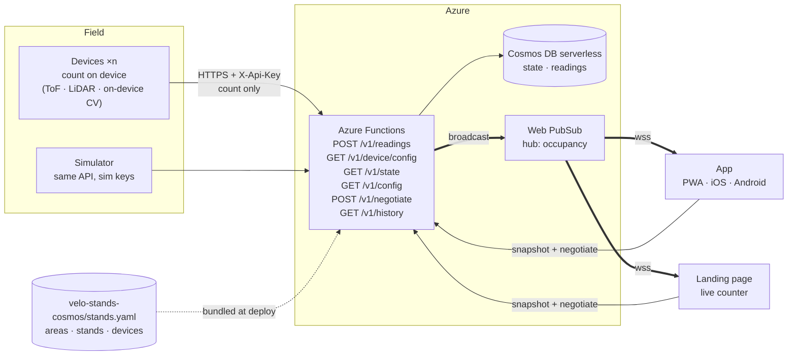
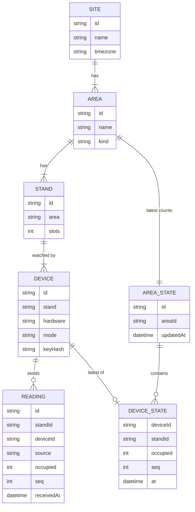

# Velo Stands architecture

BaselHack 2026 · Endress+Hauser "Find my Bike Slot"

> "Velo Stands" is a working name.

Devices at each bike stand count the bikes they see and report the number — never an image — over HTTPS. Azure Functions keep the latest state in Cosmos DB and push every change over Web PubSub to two front ends. The **app** is one build that runs as a PWA and, wrapped in Capacitor, on iOS and Android. The **landing page** promotes the project. Nobody logs in.

## Privacy stance: no images leave the stand

This is a privacy-by-design challenge. We count **without ever sending an image off the device**:

- Each device turns its raw signal (depth map, point cloud, ToF ranges, on-board inference) into one integer: the number of bikes it currently sees.
- Only that integer, plus a few housekeeping fields, reaches the backend.
- There is no cloud image endpoint. The sensor and the firmware are the whole pipeline.

See [sensor-evaluation.md](sensor-evaluation.md) for the sensors we test and the numbers we measure.

The first version only covers the API, the shared contracts, the tools and an unstyled PWA. See [build-v1.md](build-v1.md).

## Decisions

| Topic | Decision |
|---|---|
| Front ends | Two Next.js apps. The **app** is a PWA and, wrapped in Capacitor, the iOS and Android app. The **landing page** promotes the project and links to the app. |
| Push | Azure Web PubSub. Standard S1 for the demo, because the Free tier caps at 20 connections. |
| Database | Cosmos DB for NoSQL, serverless. |
| Device keys | One API key per device. Only SHA-256 hashes go in the public repo, and the keys themselves are flashed to the devices. |
| Config | YAML in the repo, validated with Zod in CI. |
| Stands | A stand has a number of slots and any number of devices. Each device sends the number of bikes it sees. Free slots = slots − the sum of all its devices' counts. |
| Devices | Devices on one stand never watch the same bikes. There are no slot ranges, no voting and no estimates for unwatched places. |
| Counting | On the device, from a non-image sensor or on-device CV. The firmware is the whole pipeline; only the integer count leaves the stand. |
| Sensor choice | Decided per area, from measurements. See [sensor-evaluation.md](sensor-evaluation.md). We expect to mix: ToF/LiDAR for small/covered stands, on-device CV on ESP32-S3 or a small SBC for wider open racks. |
| Images | The ingest path never sees one. The debug app exposes a side channel for cameras to upload the latest frame they analysed; those bytes are kept in memory only and never written to Cosmos. |

## How the pieces connect



## Components

| Part | Tech | Job |
|---|---|---|
| Devices | ToF arrays, LiDAR (e.g. RPLidar C1), mmWave radar, ultrasonic arrays, on-device CV on ESP32-S3 — one per stand or several | Count locally, every 60 s or on change, and send only the integer. TLS uses the ESP certificate bundle, so Azure certificate rotations don't break the devices. |
| Sensor evaluation | `code/firmware/experiments/*` + `documentation/sensor-evaluation.md` | For each candidate sensor: wiring, firmware spike, bench + on-site accuracy, false-positive rate, cost, power, mounting constraints. The results pick what we deploy. |
| Config | `code/backend/velo-stands-cosmos/stands.yaml` | The single source of truth for areas, stands and devices. CI validates it. The build copies it into the Function App, and copies a public subset (without hashes) into the front ends. |
| API | Azure Functions, Node 22, TypeScript | Authenticates devices, stores readings, adds up stands and areas, broadcasts changes and serves the snapshot. |
| Database | Cosmos DB for NoSQL, serverless | Holds the latest state per area, plus raw readings with a TTL for history. |
| Push | Azure Web PubSub | Sends each area update to every connected client. |
| App | Next.js static export, Serwist, Capacitor | The product: where to park right now. One build runs as an installable PWA at `app.<domain>`, and Capacitor wraps the same build for iOS and Android. |
| Landing page | Next.js static export | Promotes the project: the problem, how it works, privacy by design and the team. It shows one live counter and links to the PWA and the store builds. It is served at the root domain and is the page behind the pitch QR code. |
| Shared UI | `packages/ui` | shadcn/ui components, the Tailwind theme and the brand tokens, used by both front ends. |
| Contracts | `packages/contracts` | TypeScript types, Zod schemas and `computeViews`, used by the API and both front ends. |

## What we use

### Apps and tooling

| Tool | What it does for us |
|---|---|
| [Next.js](https://nextjs.org) | React framework for the app and the landing page. Both are static exports, so they need no server, and Capacitor can wrap the app's output. |
| [Capacitor](https://capacitorjs.com) | Wraps the app's build in native Android and iOS shells. |
| [Serwist](https://serwist.pages.dev) | Service worker and offline caching for the PWA, with a Next.js plugin. |
| [Tailwind CSS](https://tailwindcss.com) | Utility-first CSS. |
| [shadcn/ui](https://ui.shadcn.com) | Copy-in React components built on Radix and Tailwind. |
| [Radix UI](https://www.radix-ui.com) | Unstyled, accessible primitives that shadcn/ui is built on. |
| [three.js](https://threejs.org) + [React Three Fiber](https://r3f.docs.pmnd.rs) | The 3D campus model. |
| [Zod](https://zod.dev) | Schemas for the config, readings and push messages. |
| [pnpm](https://pnpm.io) | Package manager and workspaces. |
| [Oxlint](https://oxc.rs/docs/guide/usage/linter) | A fast linter. |
| [Oxfmt](https://oxc.rs/docs/guide/usage/formatter) | A Prettier-compatible formatter. Prettier is the fallback if it breaks on something. |
| [Vitest](https://vitest.dev) | Test runner. |

### Azure

| Service | What it does for us |
|---|---|
| [Azure Functions](https://learn.microsoft.com/azure/azure-functions/) | Serverless API. |
| [Cosmos DB serverless](https://learn.microsoft.com/azure/cosmos-db/serverless) | Pay-per-request database. |
| [Web PubSub](https://learn.microsoft.com/azure/azure-web-pubsub/) | Managed WebSockets. |
| [Static Web Apps](https://learn.microsoft.com/azure/static-web-apps/) | Hosting for both front ends. |
| [Terraform](https://www.terraform.io/) | Infrastructure as code (with the `azurerm` provider). |

## App screen

`code/app` is a single screen with a header (brand, total free slots, data status), the 3D campus map, and a bottom bar with **Map** and **Profile** tabs.

- The app works per **area**, not per stand: it adds up all stands of an area (`groupByArea` in `code/app/lib/parking.ts`) into one card and one pin. Capacity, occupied and free are summed per stand (a bike over capacity in one stand doesn't fill another), the area is stale if any stand is, and "updated" is its latest stand report. Stand names are never shown.
- The map shows one pin per area, coloured by occupancy (green < 60 %, amber < 85 %, orange < 100 %, red full) and labelled with free slots, plus a "you are here" dot.
- A swipeable **Nearby racks** carousel overlays the bottom of the map, sorted by distance. Swiping a card selects its pin and the camera glides to it; tapping a pin scrolls to its card. A button recenters the whole campus.
- Occupancy is **live**: the app calls `POST /v1/negotiate` and opens a WebSocket (`code/app/lib/live-stands.ts`), which receives every stand's status on connect and then every 10 s. It reconnects with backoff (1 s … 30 s) and keeps showing the last data meanwhile; the header shows Live / Connecting… / Offline.
- Each card shows the area, slots, % busy with a label (All free, Mostly free < 30 %, A bit busy < 60 %, Busy < 85 %, Almost full < 100 %, Full), free slots, walking distance and freshness ("Updated 2 min ago", "Some sensors offline", "No sensor data yet"). An area where no stand has reported gets a grey "?" pin and is left out of the header's free total.
- Area positions on the map are an **approximate** hand-made table keyed by area id (`code/app/lib/area-positions.ts`) until `stands.yaml` has real locations. The user's position is still a **mock** until device location is wired in.
- The Android app bundles the static export (`out/`) into the APK. After any web change, run `pnpm build` and `pnpm exec cap sync android` before building the APK, or the phone keeps running the old web code.
- Profile is a placeholder: nobody logs in.

## What happens when a bike is parked

1. Stand `fsw-1` at Flow South West has 20 slots and two devices. `tof-01` is a ToF array that counts occupied bays locally and sees 9 bikes; `lidar-01` is a LiDAR scanner that sees 8. Both send `POST /v1/readings`. Neither ever sends an image.
2. The Function hashes the API key and finds the device in the bundled config, which gives it the stand and the mode. The device never says who it is in the request body.
3. The Function appends the reading to `readings` with its source and stores the device's latest count in `state`. The stand then has 20 − (9 + 8) = 3 free slots. The area total is the sum of its stands.
4. A timer Function broadcasts the status of every stand through Web PubSub every 10 s, so every open client shows the new count within about 10 s.

A client calls `/negotiate` and opens the WebSocket. Web PubSub tells the Function about the new connection (`connected` event), and the Function sends that client the current snapshot right away. Every broadcast is a full snapshot, so a client that reconnects never misses anything.

## Config file

Areas are the six real bike parking areas on the campus. A stand belongs to an area and has slots, and each device belongs to a stand. An area's free and total places are the sums over its stands.

```yaml
# code/backend/velo-stands-cosmos/stands.yaml
version: 1
site:
  id: reinach
  name: Endress+Hauser Reinach
  timezone: Europe/Zurich

areas:
  - id: flow-sw
    name: Flow South West
    kind: covered            # covered | inside | open
  # … flow-main, sternenhof, flow-garage-south, flow-se, flow-garage-north

stands:
  - id: fsw-1
    area: flow-sw
    slots: 20

devices:
  # Non-image sensors or on-device CV, counting locally and sending only the integer
  - id: tof-01
    stand: fsw-1
    hardware: vl53l5cx-array   # 8×8 ToF, one head per bay group
    mode: device
    keyHash: "sha256:9f2c…e41a"
  - id: lidar-01
    stand: fsw-1
    hardware: rplidar-c1
    mode: device
    keyHash: "sha256:51b0…07cd"
    config:                    # device-specific knobs, fetched at boot
      slots: 8                 #   how many slot bays the LiDAR covers
      freeMm: 850              #   < freeMm → bike, ≥ freeMm → free (both inside bikeRange)
      reportIntervalMs: 10000  #   how often to POST a reading

settings:
  staleAfterSeconds: 300
  readingTtlDays: 30
```

To add a device, run `pnpm device:add tof-02 --stand fsw-1 --mode device --hardware vl53l5cx-array` and open a pull request. The command prints the key once, for flashing, and writes only the hash into the file. Point the devices on one stand at different bikes; the backend just adds up their counts.

### Per-device config

A device's `config:` block is a free-form mapping of knobs the firmware understands — thresholds, how many slot bays the sensor covers, report cadence, calibration windows. The backend treats it as opaque: it rides in the catalog in Cosmos and comes back verbatim through `GET /api/v1/device/config` (authenticated with `X-Api-Key`). The firmware fetches its own config on boot, falls back to its compile-time defaults if the fetch fails, and clamps every value to a plausible range so a typo in YAML can't brick a sensor. For the LiDAR firmware thor this covers `slots`, `freeMm`, `bikeRangeMinMm` / `bikeRangeMaxMm`, `emaAlpha`, `stableLatch`, `calibrationMs` and `reportIntervalMs`. New sensors add their own keys without any backend change.

## Device API

There are two endpoints, and both use the same API key header. The key identifies the device, and everything else about the device comes from the config.

### Fetch the device's own config

```http
GET /api/v1/device/config
X-Api-Key: vs_3q9Z…
```

```json
200 {
  "device": "lidar-01",
  "stand": "fsw-1",
  "slots": 20,                 // the stand's capacity
  "config": {                  // device-specific knobs, verbatim from YAML
    "slots": 8,                //   how many slot bays the LiDAR covers
    "freeMm": 850,             //   < freeMm → bike, ≥ freeMm → free (both inside bikeRange)
    "reportIntervalMs": 10000  //   single source of truth for how often to POST
  }
}
```

### Count from the device

```http
POST /api/v1/readings
X-Api-Key: vs_3q9Z…
Content-Type: application/json

{ "occupied": 9, "seq": 1842, "measuredAt": "2026-10-31T07:42:10Z", "fw": "0.3.1", "rssi": -61 }
```

```json
202 { "device": "cam-01", "nextInSeconds": 60 }
```

### Errors

| Status | When |
|---|---|
| 401 | The key is unknown or missing. |
| 409 | The device is not assigned to a stand. |
| 422 | The JSON body is invalid: a negative count, a count above the stand's slots, or an unknown field. |
| 429 | One device sent more than one request in 5 s. |

- The JSON schema has no field that could carry an image, and unknown fields are rejected. Only counts reach the backend.
- `seq` lets the server drop duplicates and out-of-order retries. Each device sends at least every 60 s, which also serves as its heartbeat.
- The server compares key hashes in constant time. Rotating a key means changing the config and reflashing one device.

## Client API and WebSocket push

The client endpoints need no authentication. They are all read-only and return counts only.

| Endpoint | Returns |
|---|---|
| `GET /api/v1/state` | `Snapshot` |
| `GET /api/v1/config` | The public config, without key hashes |
| `GET /api/v1/stands` | Every active stand: name, area, current and max occupancy, free, stale, updatedAt |
| `POST /api/v1/negotiate` | `{ url }`, a Web PubSub URL (valid 60 min) that can only receive |
| `POST /api/v1/pubsub/events` | Called by Web PubSub, not by clients: on `connected` the Function sends the new connection the current snapshot |
| `GET /api/v1/history?stand=…&from=…&to=…` | The stand's readings, oldest first |
| `GET /api/v1/debug/devices` | Per-device summary for the debug app: public info plus `lastSeenAt`, `stale` and `lastImage` |
| `GET /api/v1/debug/devices/{deviceId}/logs?limit=200` | Recent log lines of one device, from an in-memory ring buffer the ingest handler writes to |
| `GET /api/v1/debug/devices/{deviceId}/image` | The latest JPEG the device uploaded for debug viewing, or 404 if none yet |
| `POST /api/v1/debug/images` | A device uploads its latest frame for the debug app. `X-Api-Key` + `Content-Type: image/jpeg` (cameras) or `image/svg+xml` (non-image sensors send a vector sketch of what they see). In-memory only, never written to Cosmos |

```json
GET /api/v1/state
{
  "at": "2026-10-31T07:42:11Z",
  "areas": [
    { "id": "flow-sw", "name": "Flow South West", "kind": "covered",
      "capacity": 20, "free": 3, "stale": false,
      "stands": [ { "id": "fsw-1", "slots": 20, "occupied": 17, "free": 3, "stale": false } ] }
  ]
}
```

```js
// browser and Capacitor app alike
const { url } = await (await fetch(`${API}/api/v1/negotiate`, { method: "POST" })).json();
const ws = new WebSocket(url);
ws.onmessage = (e) => apply(JSON.parse(e.data));

// each message: the body of GET /api/v1/stands plus `type`
{ "type": "stands", "at": "…", "stands": [
  { "id": "kaegen-hof-1", "name": "Kägenstrasse 2 – Hof, Stand 1", "areaId": "kaegen-hof", "areaName": "Kägenstrasse 2 – Hof",
    "currentOccupancy": 8, "maxOccupancy": 40, "free": 32, "stale": false, "updatedAt": "…" } ] }
```

- Azure Functions can't hold WebSockets, so Web PubSub (hub `occupancy`) holds them and the Functions only send.
- A timer Function broadcasts the full snapshot every 10 s (`PUSH_SCHEDULE`). Staleness is worked out on each broadcast, so a quiet device shows up without extra work.
- A new connection gets the snapshot at once through the `connected` event handler, instead of waiting for the next broadcast.

## Data model

The data model has three layers:
- **Config** describes what exists. It comes from `stands.yaml` and changes only by pull request.
- **Stored** is what the devices told us, kept in Cosmos DB.
- **Views** are computed from the two on every read and never stored, so no derived number can drift.



### Config (`packages/contracts`)

```ts
type AreaKind = "covered" | "inside" | "open";
type DeviceMode = "device"; // devices count locally and POST the integer

interface Site   { id: string; name: string; timezone: string }
interface Area   { id: string; name: string; kind: AreaKind }
interface Stand  { id: string; area: Area["id"]; name?: string; slots: number } // slots >= 1
interface Device {
  id: string;
  stand: Stand["id"];
  hardware: string;            // "esp32-cam", "rplidar-c1", … free text
  mode: DeviceMode;
  keyHash: `sha256:${string}`; // never shipped to the front ends
}
interface Settings    { staleAfterSeconds: number; readingTtlDays: number }

interface Config {
  version: 1; site: Site; areas: Area[]; stands: Stand[]; devices: Device[];
  settings: Settings;
}
```

CI also checks what the types can't: ids are unique per kind, every `area` and `stand` reference resolves, every area has at least one stand, every stand has at least one device, and key hashes are unique.

### Stored (Cosmos DB)

```ts
// container "readings", partition key /standId, default TTL 30 days
interface Reading {
  id: string;              // uuid
  standId: string;
  areaId: string;          // denormalised for history by area
  deviceId: string;
  source: "device";
  occupied: number;        // bikes this device sees, 0 … stand.slots
  seq: number;
  measuredAt?: string;     // ISO 8601, only if the device has NTP time
  receivedAt: string;
  fw?: string;
  rssi?: number;
}

// container "state", partition key /areaId, one document per area, no TTL
interface AreaState {
  id: string;              // = areaId
  areaId: string;
  devices: Record<string, DeviceState>; // keyed by deviceId
  updatedAt: string;
}
interface DeviceState {
  standId: string;
  occupied: number;
  source: "device";
  seq: number;
  at: string;              // receivedAt of the reading that set it
}
```

Ingest writes one device's entry with a Cosmos **patch** (`set /devices/cam-01`), guarded by `seq`. That way two devices in the same area never overwrite each other, and no read-modify-write is needed. Nothing else is stored: no images, no people and no identity for individual bikes.

### Views (computed on read)

```ts
interface StandView  { id: string; slots: number; occupied: number; free: number; stale: boolean }
interface AreaView   { id: string; name: string; kind: AreaKind;
                       capacity: number; free: number; stale: boolean; stands: StandView[] }
interface Snapshot   { at: string; areas: AreaView[] }                 // GET /v1/state
interface AreaUpdate { type: "area"; id: string; capacity: number;
                       free: number; stale: boolean; at: string }       // WebSocket message
```

| Value | Rule |
|---|---|
| `stand.occupied` | The sum of the latest `occupied` of every device on the stand. A device that never reported counts as 0. |
| `stand.free` | `max(0, slots − occupied)`. It is clamped because two cameras can both see a bike on their shared edge. |
| `stand.stale` | True if any of its devices has not reported within `staleAfterSeconds`, or has never reported. |
| `area.capacity` / `area.free` | The sum of its stands' `slots` / `free`. Places that no device watches don't appear. |
| `area.stale` | True if any of its stands is stale. |

These rules live in one pure function, `computeViews(config, states, now)`, in `packages/contracts`. It is tested with Vitest and used by both `/state` and the broadcast.

**Volume.** Ten devices reporting once a minute make about 14,000 readings a day, which costs a few cents in serverless request units.

