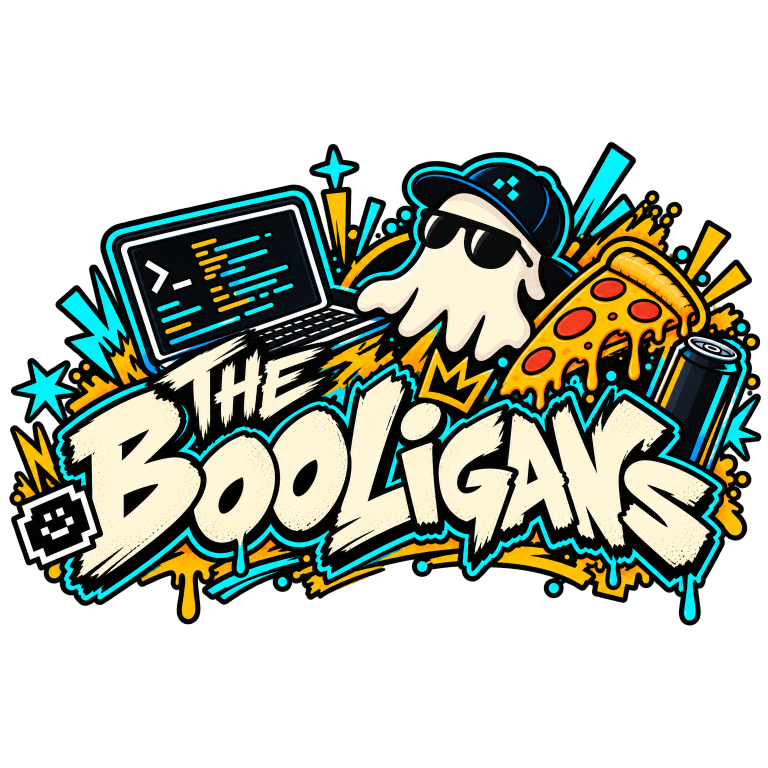

<p align="center">
  
</p>

# Slot Invaders

[](https://github.com/The-Booligans/slotinvaders/actions/workflows/ci.yml)

[](https://www.baselhack.ch/)
[](https://www.endress.com/)
[](license.txt)
[](#privacy-first--no-images-leave-the-stand)
[](documentation/sensor-evaluation.md)

[](https://www.typescriptlang.org/)
[](https://nodejs.org/)
[](https://nextjs.org/)
[](https://capacitorjs.com/)
[](https://tailwindcss.com/)
[](https://ui.shadcn.com/)
[](https://threejs.org/)
[](https://pnpm.io/)
[](https://vitest.dev/)

[](https://learn.microsoft.com/azure/azure-functions/)
[](https://learn.microsoft.com/azure/cosmos-db/)
[](https://learn.microsoft.com/azure/azure-web-pubsub/)
[](https://www.terraform.io/)

[](https://www.espressif.com/en/products/socs/esp32)
[](documentation/sensor-evaluation.md)

**Find my Bike Slot** — a BaselHack 2026 entry for the Endress+Hauser challenge.

> How might we help employees quickly find an available bicycle parking slot at
> our company site?

Slot Invaders turns the six bike parking areas on the Endress+Hauser Reinach
campus into live counters. Sensors at each stand report how many bikes they
see; the app shows you where to park before you arrive.

## Live environments

| URL                                             | What it is                                                          |
| ----------------------------------------------- | ------------------------------------------------------------------- |
| [slotinvaders.ch](https://slotinvaders.ch)      | Landing page                                                        |
| [app.slotinvaders.ch](https://app.slotinvaders.ch/) | The app                                                             |
| [debug.slotinvaders.ch](https://debug.slotinvaders.ch/) | Development environment to test and research devices and sensors |

## Privacy first — no images leave the stand

The challenge is explicit: **no faces, no license plates, no identifying or
tracking individuals.** We take that further.

We offer **two on-device solutions**. Both report only the integer; the image
or point cloud never leaves the stand.

- **LiDAR (preferred).** One 360° RPLidar C1 head per stand, mounted on the
  ceiling. Works day, night, rain, snow — the signal is depth, not light.
- **On-device YOLO on ESP32 cameras.** Where no LiDAR mounting is available.
  Each stand gets **two cameras**, top-left and top-right at ≈ 30° downward
  into the stand, both running YOLO11 locally. The frame stays in RAM; only
  the count is POSTed.

Details and numbers in
[`documentation/sensor-evaluation.md`](documentation/sensor-evaluation.md).

## The idea in one picture

```
 ┌─ Field ──────────────────────┐      ┌─ Azure ─────────────────┐      ┌─ Clients ──┐
 │ LiDAR  (1× per stand)        │─────▶│ Functions · Cosmos DB   │─────▶│ PWA        │
 │ or on-device YOLO (2× per    │      │ Web PubSub              │      │ iOS/Android│
 │   stand, 30° top-L + top-R)  │      │                         │      │ Landing    │
 │   ─────  integer only  ────▶ │      │                         │      │            │
 └──────────────────────────────┘      └─────────────────────────┘      └────────────┘
```

Devices `POST /v1/readings` with their count. Free slots = stand slots − sum
of device counts. Updates go out via WebSockets, so every open client refreshes
within about a second.

See [`documentation/architecture.md`](documentation/architecture.md) for the
full picture, data model and API.

## Repository layout

Following the [BaselHack repo template](https://github.com/BaselHack/baselhack_repo_template):

| Folder          | Contents                                                        |
| --------------- | --------------------------------------------------------------- |
| `code/`         | all code — `app/`, `backend/`, `firmware/`, `webpage/`, `debug/`, `common/` |
| `documentation/`| architecture, sensor evaluation, challenge brief, hackathon rules |
| `assets/`       | pitch materials, videos, presentations                          |

Sensor spikes live under `code/firmware/experiments/<sensor>/` so results can
be reproduced.

## Run the app

1. Open a terminal in `code/app` and install dependencies once:
   `pnpm install`
2. Run the web app locally:
   `pnpm run dev`
   Then open `http://localhost:3000`.
3. To run it on Android, build the static web app and sync it into the native
   project:
   `pnpm run build`
   `pnpm exec cap sync android`
4. Open `code/app/android` in Android Studio (or run `pnpm exec cap open android`
   from `code/app`).
5. Select an emulator or connected Android device, then click **Run**.

After changing app code, repeat steps 3–5 so Android gets the latest build.

## Stack

- **Front ends** — Next.js (static export) · Serwist (PWA) · Capacitor (iOS/Android) · shadcn/ui · Tailwind · three.js + R3F
- **Backend** — Azure Functions (Node 22, TypeScript) · Cosmos DB serverless · Web PubSub
- **Counting** — RPLidar C1 on an AtomS3 (default) · AtomS3R-CAM-M12 running ESP-DL YOLO11n on-device (two per stand, top-L + top-R at 30°)
- **Shared** — Zod schemas, TypeScript contracts, `computeViews` pure function
- **Tooling** — pnpm workspaces · Oxlint · Oxfmt · Vitest · Terraform

## Challenge

- **Event**: BaselHack 2026 · Fri 30 Oct – Sun 1 Nov 2026 · 48h
- **Challenge owner**: Endress+Hauser
- **Site**: Reinach campus — 2 property zones, 6 bike parking areas
- **Hardware provided**: 10× ESP32 cameras with boards (we use them for on-device CV)

Full brief in [`documentation/challenge-brief.md`](documentation/challenge-brief.md).
Hackathon rules and judging notes in
[`documentation/baselhack-rules.md`](documentation/baselhack-rules.md).

## Team

The Booligans:

- Dobrawa Kiefer
- Nila M.
- Artur Semenenko
- Luca Rullo
- Samuel Rink
- Valentino Rusconi
- David Übelacker

## License

MIT — see [`license.txt`](license.txt). All artifacts are published openly, in
line with the BaselHack rules.
